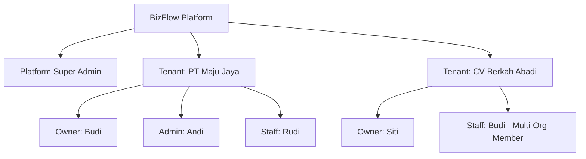
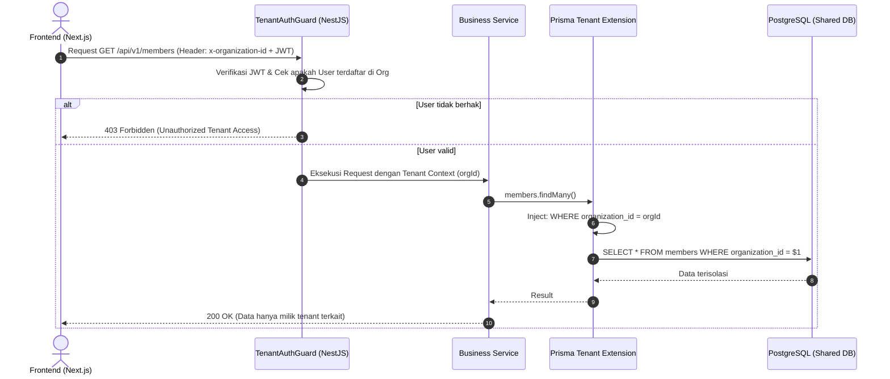

# Product Requirements Document (PRD)
## Project: BizFlow — Multi-Tenant SaaS Management Platform

**Document Version:** 1.0.0  
**Status:** Approved for Implementation  
**Target Stack:** Next.js (TypeScript), NestJS, PostgreSQL, Prisma, Redis, Midtrans, Docker  

---

## 1. Executive Summary & Product Vision

### 1.1 Ringkasan Produk
**BizFlow** adalah platform Software-as-a-Service (SaaS) manajemen bisnis dan operasional berbasis web modern yang dirancang untuk mendukung model **B2B Multi-Tenancy**. Platform ini memungkinkan berbagai perusahaan (organisasi) mendaftar, mengelola operasional harian, tim internal, peran hak akses, dan paket langganan secara terisolasi dalam satu infrastruktur aplikasi bersama.

### 1.2 Masalah yang Diselesaikan (Problem Statement)
* **Silo Operasional & Fragmentasi Tool**: Perusahaan skala kecil hingga menengah sering menggunakan berbagai alat terpisah untuk mencatat tim, aktivitas, dan langganan.
* **Biaya Infrastruktur Tinggi untuk Single-Tenant**: Membangun aplikasi terpisah untuk setiap klien mahal dan sulit di-maintain. Multi-tenant shared-database memungkinkan efisiensi biaya infrastruktur optimal.
* **Kompleksitas Hak Akses Perusahaan**: Perusahaan membutuhkan fleksibilitas hak akses (Owner, Admin, Manager, Staff) dengan boundary data yang aman agar data antar-departemen atau antar-perusahaan tidak bocor.

### 1.3 Nilai Utama Proyek
1. **Multi-Tenancy Sejati**: Satu akun pengguna dapat tergabung dalam beberapa organisasi (misal: Owner di PT Maju Jaya, Staff di CV Berkah Abadi) dan dapat berpindah workspace secara dinamis.
2. **Kemandirian Tenant (Data Isolation)**: Jaminan isolasi data 100% menggunakan arsitektur *Shared Database, Shared Schema* dengan pembatasan ketat di level backend application layer.
3. **Monetisasi Otomatis**: Integrasi payment gateway lokal (Midtrans) dengan flow verifikasi webhook otomatis dan sistem upgrade/downgrade paket subscription.

---

## 2. User Personas & Role Matrix

Sistem memiliki dua level ekosistem: **Platform Level (Super Admin)** dan **Tenant Level (Organization Members)**.

### 2.1 User Personas

| Persona | Konteks Akses | Tanggung Jawab Utama | Kebutuhan Kunci |
|---|---|---|---|
| **Platform Super Admin** | Platform System Dashboard | Mengelola seluruh ekosistem SaaS, memantau tenant, pendapatan, dan kesehatan server. | Global analytics, tenant suspension, master plan configuration. |
| **Organization Owner** | Workspace Organisasi | Pemilik akun perusahaan pembayar langganan. | Billing & subscription, team management, hak akses penuh. |
| **Organization Admin** | Workspace Organisasi | Delegasi pengelola operasional harian organisasi. | Manajemen user, melihat audit log, export report. |
| **Manager** | Workspace Organisasi | Pengawas divisi / unit kerja di organisasi. | Melihat laporan aktivitas, melihat dashboard analitik. |
| **Staff** | Workspace Organisasi | Anggota tim pelaksana operasional. | Akses dashboard standar dan fitur sesuai izin tugas. |

### 2.2 Role-Based Access Control (RBAC) Matrix (Tenant Level)

| Fitur / Tindakan | Owner | Admin | Manager | Staff |
|---|:---:|:---:|:---:|:---:|
| **Lihat Dashboard Organisasi** | ✅ | ✅ | ✅ | ✅ |
| **Undang Anggota Tim Baru** | ✅ | ✅ | ❌ | ❌ |
| **Ubah Role Anggota Tim** | ✅ | ✅ (Non-Owner) | ❌ | ❌ |
| **Hapus Anggota Tim** | ✅ | ✅ (Non-Owner) | ❌ | ❌ |
| **Ubah Profil & Nama Workspace** | ✅ | ❌ | ❌ | ❌ |
| **Pilih & Bayar Paket Langganan** | ✅ | ❌ | ❌ | ❌ |
| **Akses Riwayat Invoice & Pembayaran** | ✅ | ✅ | ❌ | ❌ |
| **Lihat Audit Trail / Activity Logs** | ✅ | ✅ | ❌ | ❌ |
| **Export Laporan (PDF / Excel)** | ✅ | ✅ | ✅ | ❌ |
| **Hapus / Tutup Organisasi** | ✅ | ❌ | ❌ | ❌ |

---

## 3. Fitur Utama & Spesifikasi Fungsional

### 3.1 Authentication & Workspace Switching
* **Registrasi & Email Verification**: Pengguna mendaftar dengan email + password. Mengirim token verifikasi via email.
* **Multi-Org Identity**: Satu `User` dapat memiliki relasi ke banyak `Organization` melalui tabel pivot `OrganizationMember`.
* **Workspace Switcher**: Pengguna dapat berganti tenant yang aktif melalui dropdown UI. Setiap request API berikutnya menyertakan header konteks tenant: `x-organization-id: <org_uuid>`.
* **JWT Access & Refresh Token**: Access token pendek (15 menit) + Refresh token rotatif (7 hari) tersimpan di secure HTTP-only cookies atau Authorization header.

### 3.2 Multi-Tenant Organization Management
* Pembuatan organisasi baru pasca-registrasi pertama kali atau pembuatan organisasi tambahan.
* Pengaturan profil organisasi: Logo, nama legal, domain/slug workspace, zona waktu, dan mata uang.
* Penghapusan/penonaktifan organisasi secara soft-delete.

### 3.3 Team Management & Token-based Invitation
* **Undangan via Email**: Mengirim link undangan dengan token unik bertenggat waktu (misal: aktif 48 jam).
* **Alur Penerimaan**:
  * Jika email sudah terdaftar: Anggota langsung ditambahkan ke organisasi setelah klik konfirmasi.
  * Jika email belum terdaftar: Diarahkan ke form pendaftaran akun terlebih dahulu, kemudian otomatis bergabung.
* **Manajemen Keanggotaan**: Status member (`INVITED`, `ACTIVE`, `SUSPENDED`).

### 3.4 Subscription & Feature Gating
Sistem subscription membatasi fitur berdasarkan paket yang aktif:

| Parameter Paket | Free Tier | Starter Plan | Business Plan | Enterprise Plan |
|---|:---:|:---:|:---:|:---:|
| **Harga** | Rp0 | Rp99.000 / bln | Rp299.000 / bln | Custom |
| **Maksimal Anggota Tim** | 2 Member | 5 Member | 20 Member | Unlimited |
| **Dashboard Analytics** | Basic | Standard | Advanced | Real-Time Dedicated |
| **Export Laporan (PDF/Excel)** | ❌ | ❌ | ✅ | ✅ |
| **Audit Activity Logs** | ❌ | ❌ | ✅ (30 Hari) | ✅ (1 Tahun) |
| **Priority Support** | ❌ | ❌ | Email | Dedicated SLA |

* **Feature Guarding di Backend**: Setiap endpoint fitur berbayar (misal: `/reports/export`) dilindungi oleh Guard NestJS yang memvalidasi kuota dan paket langganan tenant aktif.

### 3.5 Payment Gateway Integration (Midtrans)
* **Metode Pembayaran**: Virtual Account (BCA, Mandiri, BNI, BRI), QRIS (GoPay/ShopeePay/dana), dan Kartu Kredit.
* **Alur Transaksi Snap**:
  1. Frontend request checkout paket -> Backend NestJS membuat pesanan (`Payment` record dengan status `PENDING`) dan request `snap_token` ke Midtrans Core/Snap API.
  2. Frontend menampilkan modal Midtrans Snap Popup.
  3. Pelanggan menyelesaikan pembayaran.
  4. Midtrans mengirimkan **HTTP POST Webhook Notification** ke backend NestJS.
  5. Backend memvalidasi `signature_key` (SHA512 dari `order_id + status_code + gross_amount + server_key`).
  6. Setelah valid, status pembayaran diupdate ke `SUCCESS`, masa aktif `Subscription` diperpanjang, dan faktur (`Invoice`) dibuat otomatis.

### 3.6 Audit Logging System
* Mencatat aktivitas penting tenant:
  * Siapa (`actor_id`, `actor_name`)
  * Organisasi (`organization_id`)
  * Tindakan (`action`: misal `MEMBER_INVITED`, `ROLE_CHANGED`, `PLAN_UPGRADED`)
  * Target data (`target_type`, `target_id`)
  * IP Address & User Agent
  * Timestamp kejadian
* Audit log bersifat *immutable* (tidak dapat diubah atau dihapus oleh siapapun di level aplikasi).

### 3.7 Export Laporan (PDF & Excel)
* **Excel (.xlsx)**: Export daftar anggota tim, ringkasan transaksi billing, dan rekap log aktivitas menggunakan pustaka stream (misal: `exceljs`).
* **PDF (.pdf)**: Cetak faktur (invoice) resmi per transaksi langganan dan laporan ringkasan bulanan organisasi.

---

## 4. Arsitektur Multi-Tenancy

### 4.1 Strategi: Shared Database, Shared Schema
Pendekatan yang dipilih untuk efisiensi resource dan kemudahan maintenance database:
* Semua tenant berbagi satu instance PostgreSQL dan skema database bersama (`public`).
* Setiap tabel yang memuat data milik tenant **wajib** memiliki kolom `organization_id UUID NOT NULL`.
* **Tenant Isolation Engine**: NestJS Request Interceptor / Guard mengekstrak `organization_id` dari header `x-organization-id` atau JWT payload, memverifikasi bahwa user yang bersangkutan memiliki keanggotaan aktif di organisasi tersebut, lalu menginjeksikan scoped filter ke Prisma query (menggunakan Prisma Client Extensions / Middleware).

---

## 5. Non-Functional Requirements (NFR)

1. **Security**:
   * Password di-hash menggunakan algoritma `Argon2id` atau `bcrypt` (salt factor 12).
   * Perlindungan terhadap SQL Injection melalui Prisma prepared statement.
   * Rate limiting pada endpoint sensitif (Login, Register, Forgot Password, Midtrans Checkout) menggunakan Redis Throttler.
   * CORS ketat dan proteksi CSRF pada stateful cookie session.
2. **Performance**:
   * Response time p95 untuk API query data operasional di bawah 200ms.
   * Caching data yang sering dibaca (profil organisasi, paket langganan) di Redis dengan TTL terukur.
3. **Reliability & Idempotency**:
   * Endpoint Webhook Midtrans harus bersifat **idempotent** (menerima webhook ganda untuk order ID yang sama tidak akan menggandakan penambahan durasi subscription).
4. **Data Privacy**:
   * Tenant A tidak dapat menebak atau mengakses data Tenant B melalui *IDOR (Insecure Direct Object References)* berkat validasi lapis Guard + DB Query Scoping.

---

## 6. Ruang Lingkup & Batasan (Scope & Boundaries)

### Dalam Ruang Lingkup (In-Scope - MVP to Production)
* Autentikasi lengkap (Register, Login, Multi-Org switcher, Reset Password).
* RBAC statis (Owner, Admin, Manager, Staff) dengan permission matrix.
* Modul Subscription, Pricing Table, dan Checkout Midtrans (Sandbox & Prod).
* Webhook handler Midtrans dan generator Invoice PDF.
* Audit activity log terfilter per tenant.
* Super Admin dashboard untuk memantau seluruh tenant.

### Di Luar Ruang Lingkup (Out-of-Scope untuk Rilis Pertama)
* Custom domain per tenant (misal: `pt-majujaya.bizflow.com` atau domain pribadi klien) — dialokasikan untuk fase Enterprise lanjutan.
* Kustomisasi role dinamis (*custom permissions creator* oleh owner).
* Integrasi multi-payment gateway global (Stripe/PayPal) — fokus pada Midtrans terlebih dahulu.
