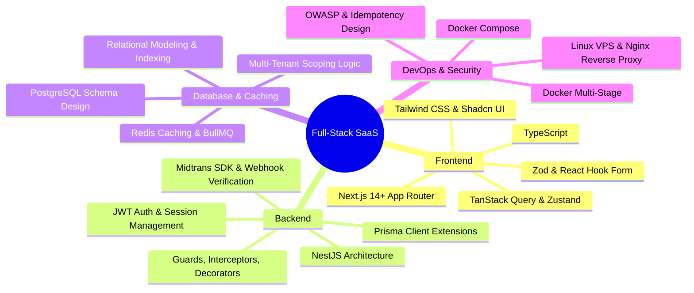
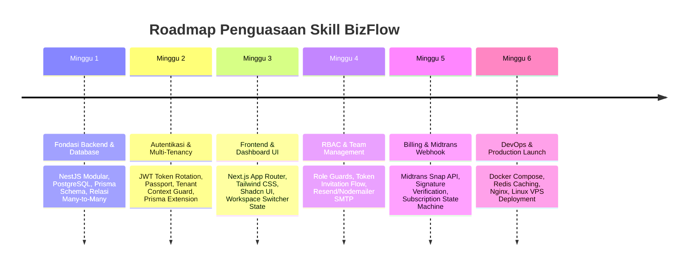

# Skill & Kompetensi yang Dibutuhkan
## Panduan Penguasaan Teknologi untuk Membangun Multi-Tenant SaaS (BizFlow)

Dokumen ini memetakan seluruh keahlian teknis, konsep arsitektur, dan peta belajar (*learning roadmap*) yang diperlukan untuk membangun proyek SaaS Multi-Tenant end-to-end secara profesional.

---

## 1. Matriks Kebutuhan Skill Berdasarkan Domain

---

## 2. Rincian Kompetensi Teknis Per Lapisan

### 2.1 Backend Engineering (NestJS & Node.js)
Membangun backend enterprise membutuhkan pemahaman arsitektur berlapis (*layered architecture*), bukan sekadar routing API:

1. **Modular Architecture & Dependency Injection**:
   * Memisahkan fungsionalitas ke dalam modul independen: `AuthModule`, `OrganizationModule`, `UserModule`, `SubscriptionModule`, `PaymentModule`, `AuditLogModule`.
   * Memahami scope Provider (`DEFAULT`, `REQUEST`, `TRANSIENT`) dan dampaknya pada performa aplikasi.
2. **NestJS Guards & Pipeline Execution**:
   * `JwtAuthGuard`: Memverifikasi validitas token JWT dari request header / cookie.
   * `TenantContextGuard`: Mengekstrak `x-organization-id`, memverifikasi relasi user terhadap tenant, dan menyuntikkan data tenant ke dalam `request.tenant`.
   * `RolesGuard`: Mengevaluasi metadata role pengguna saat mengakses endpoint tertentu (misal `@Roles('OWNER', 'ADMIN')`).
3. **Custom Decorators & Interceptors**:
   * Membuat custom parameter decorator `@CurrentTenant()` dan `@CurrentUser()` untuk mempermudah injeksi data terotentikasi di level controller.
   * `AuditLogInterceptor`: Mencatat otomatis aktivitas request mutasi data (`POST`, `PUT`, `DELETE`) ke tabel audit log tanpa mengotori business logic service.
4. **Validation & Exception Handling**:
   * Penggunaan `ValidationPipe` global dengan `class-validator` dan `class-transformer`.
   * Pembuatan custom exception filter untuk menyeragamkan format respon error (`{ statusCode, message, error, timestamp, path }`).

---

### 2.2 Database & Multi-Tenancy (PostgreSQL & Prisma)
Multi-tenancy menuntut integritas data tingkat tinggi agar data antar organisasi tidak pernah saling bocor (*cross-tenant data leak*):

1. **Relational Data Modeling**:
   * Memodelkan relasi Many-to-Many antara `User` dan `Organization` dengan tabel pivot `OrganizationMember` yang memuat kolom `role` spesifik per organisasi.
   * Menyusun indeks komposit (misal: `@@unique([userId, organizationId])`, `@@index([organizationId, createdAt])`) untuk memastikan query tenant cepat dan bebas redudansi.
2. **Prisma ORM Mastery**:
   * Menulis schema Prisma yang bersih, relasi one-to-many, many-to-many, dan enum.
   * Mengelola Prisma Migrations (`prisma migrate dev`, `prisma migrate deploy`) secara aman tanpa data loss.
   * Menggunakan Database Transactions (`prisma.$transaction`) saat mengeksekusi operasi krusial (misalnya: pembuatan organisasi baru sekaligus menambahkan user sebagai `OWNER` dan membuat record subscription default).
3. **Tenant Scoping Enforcement**:
   * Memanfaatkan **Prisma Client Extensions** (`$extends`) untuk melakukan auto-query injection, sehingga setiap pemanggilan query otomatis menambahkan filter `where: { organizationId: currentTenantId }`.

---

### 2.3 Frontend Engineering (Next.js, TypeScript, Tailwind)
Frontend SaaS B2B menuntut UX yang responsif, manajemen state organisasi yang konsisten, dan keamanan di sisi klien:

1. **Next.js App Router & Hybrid Rendering**:
   * Memahami perbedaan Server Components (RSC) untuk fetching data cepat dan Client Components (`"use client"`) untuk interaktivitas UI dashboard.
   * Penggunaan Route Groups `(auth)`, `(dashboard)`, `(landing)` untuk pemisahan layout yang bersih.
   * Next.js Middleware (`middleware.ts`) untuk proteksi rute halaman sebelum render terjadi di browser.
2. **UI & Design System**:
   * **Tailwind CSS**: Utility-first styling yang konsisten dan mudah di-maintain.
   * **Shadcn UI & Radix Primitives**: Pustaka komponen headless yang fleksibel (Dialogs, Dropdowns, Data Table, Tabs, Forms).
   * **Lucide Icons**: Library ikon modern untuk dashboard.
3. **State Management & Data Fetching**:
   * **Zustand**: Menyimpan state aktif tenant (`currentOrganization`) yang dipilih di navbar agar sinkron di seluruh komponen.
   * **TanStack Query (React Query)**: Caching data server, revalidasi background, optimistik update, dan pagination query tabel data.
4. **Form Handling & Validasi**:
   * Kombinasi **React Hook Form** + **Zod** schema validation untuk validasi input form yang ketat di sisi klien sebelum dikirim ke backend.

---

### 2.4 Integrasi Payment Gateway & Webhook (Midtrans)
Menghubungkan aplikasi dengan aliran uang nyata menuntut pemahaman arsitektur transaksi yang andal:

1. **Midtrans Core / Snap API**:
   * Pembuatan parameter transaksi (`order_id`, `gross_amount`, `customer_details`, `item_details`).
   * Menghandle popup pembayaran Midtrans Snap di frontend Next.js.
2. **Webhook Security & Signature Verification**:
   * Menghitung hash SHA512 dari kombinasi `order_id + status_code + gross_amount + ServerKey` untuk memastikan notifikasi HTTP POST benar-benar berasal dari Midtrans.
3. **Idempotency & State Reconciliation**:
   * Mencegah pemrosesan ganda (*double credit*) jika Midtrans melakukan retry kirim webhook.
   * Menangani semua status siklus pembayaran: `settlement`, `capture`, `pending`, `deny`, `expire`, `cancel`.

---

### 2.5 Asynchronous Tasks & Caching (Redis)
1. **Redis Caching**:
   * Cache invalidation pattern (menghapus cache organisasi ketika admin mengupdate data).
   * Rate limiting / IP throttling untuk melindungi API dari brute force dan DDoS.
2. **Background Jobs / Message Queues (BullMQ / Redis)**:
   * Mengirim email undangan tim dan notifikasi secara asynchronous agar tidak memblokir respon HTTP request.
   * Pembuatan file PDF invoice dan export file Excel secara background.

---

### 2.6 DevOps, Containerization & Deployment
1. **Docker**:
   * Menulis `Dockerfile` multi-stage build yang meminimalisir ukuran image (Next.js standalone build & NestJS compiled dist).
   * Menulis `docker-compose.yml` untuk menjalankan PostgreSQL, Redis, NestJS API, dan Next.js secara harmonis.
2. **Server Deployment (VPS Linux Ubuntu)**:
   * Konfigurasi firewall (`ufw`), manajemen user non-root SSH.
   * Konfigurasi **Nginx** sebagai reverse proxy ke aplikasi Docker.
   * Pengaturan sertifikat HTTPS gratis menggunakan **Let's Encrypt / Certbot** dengan auto-renewal.
   * Manajemen environment variables (`.env`) yang aman di server produksi.

---

## 3. Peta Belajar Bertahap (Step-by-Step Learning Roadmap)

Bagi seorang developer yang ingin membangun proyek ini dari nol tanpa merasa kewalahan, ikuti urutan belajar berikut:

### Milestone Mingguan:

* **Fase 1: Backend & DB Foundation**
  * Target: Mampu merancang skema relasional di Prisma, menjalankan migrasi, dan memahami arsitektur Controller-Service-Repository di NestJS.
* **Fase 2: Multi-Tenancy Engine**
  * Target: Berhasil membuat guard yang menolak request jika user mencoba mengakses data organisasi lain (pembuktian isolasi data).
* **Fase 3: Modern Frontend Experience**
  * Target: Menampilkan layout dashboard responsif dengan dropdown organisasi yang aktif dan data terfilter otomatis.
* **Fase 4: Akses & Kolaborasi Tim**
  * Target: Mengirim email undangan riil, menerima undangan, dan memvalidasi izin role pengguna pada tombol aksi UI.
* **Fase 5: Monetisasi Nyata**
  * Target: Menyelesaikan transaksi via Midtrans Sandbox dan melihat status subscription terupdate otomatis via webhook.
* **Fase 6: Kontainerisasi & Live Deploy**
  * Target: Seluruh aplikasi berjalan stabil di VPS Linux dengan domain HTTPS dan container Docker terisolasi.
