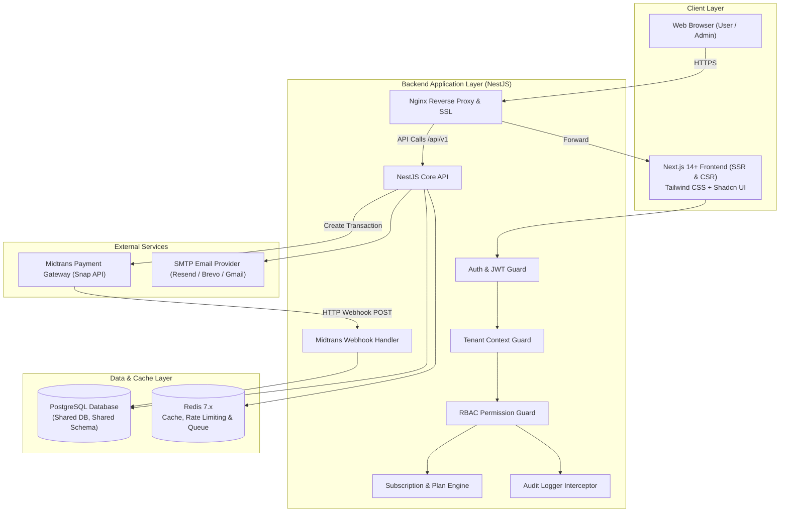
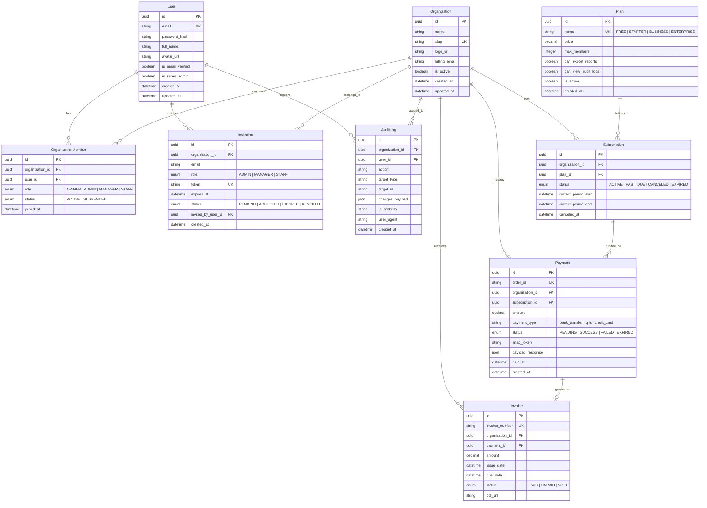
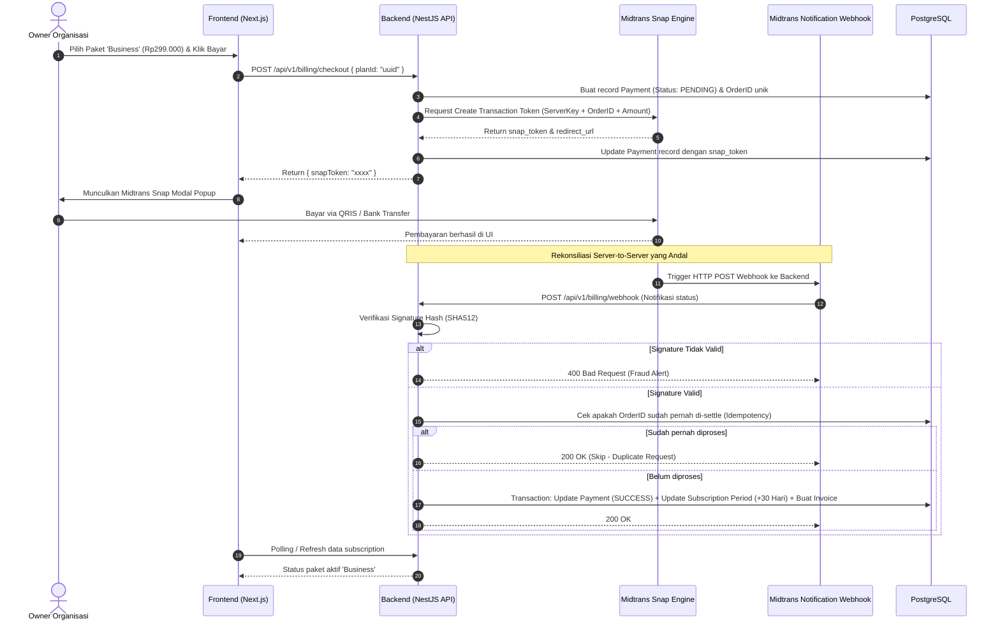

# Arsitektur Sistem & Desain Database
## BizFlow Multi-Tenant SaaS Management Platform

Dokumen ini menjelaskan detail teknis arsitektur sistem, skema database relasional (ERD & Prisma), mekanisme isolasi tenant, dan alur transaksi pembayaran.

---

## 1. Arsitektur Sistem Tingkat Tinggi (High-Level Architecture)

Aplikasi dibangun dengan arsitektur decoupled (terpisah antara Frontend dan Backend) dengan komunikasi berbasis REST API dan Webhook:



---

## 2. Entity-Relationship Diagram (ERD)

Berikut adalah relasi antar tabel data di dalam PostgreSQL:



---

## 3. Spesifikasi Skema Database (Prisma Schema Reference)

Di bawah ini adalah draf lengkap `schema.prisma` yang siap diimplementasikan:

```prisma
datasource db {
  provider = "postgresql"
  url      = env("DATABASE_URL")
}

generator client {
  provider = "prisma-client-js"
}

enum Role {
  OWNER
  ADMIN
  MANAGER
  STAFF
}

enum MemberStatus {
  ACTIVE
  SUSPENDED
}

enum InvitationStatus {
  PENDING
  ACCEPTED
  EXPIRED
  REVOKED
}

enum SubscriptionStatus {
  ACTIVE
  PAST_DUE
  CANCELED
  EXPIRED
}

enum PaymentStatus {
  PENDING
  SUCCESS
  FAILED
  EXPIRED
}

enum InvoiceStatus {
  PAID
  UNPAID
  VOID
}

model User {
  id                String               @id @default(uuid()) @db.Uuid
  email             String               @unique @db.VarChar(255)
  passwordHash      String               @map("password_hash") @db.VarChar(255)
  fullName          String               @map("full_name") @db.VarChar(100)
  avatarUrl         String?              @map("avatar_url") @db.VarChar(500)
  isEmailVerified   Boolean              @default(false) @map("is_email_verified")
  isSuperAdmin      Boolean              @default(false) @map("is_super_admin")
  createdAt         DateTime             @default(now()) @map("created_at")
  updatedAt         DateTime             @updatedAt @map("updated_at")

  memberships       OrganizationMember[]
  sentInvitations   Invitation[]         @relation("InvitedByUser")
  auditLogs         AuditLog[]

  @@map("users")
}

model Organization {
  id           String               @id @default(uuid()) @db.Uuid
  name         String               @db.VarChar(150)
  slug         String               @unique @db.VarChar(100)
  logoUrl      String?              @map("logo_url") @db.VarChar(500)
  billingEmail String?              @map("billing_email") @db.VarChar(255)
  isActive     Boolean              @default(true) @map("is_active")
  createdAt    DateTime             @default(now()) @map("created_at")
  updatedAt    DateTime             @updatedAt @map("updated_at")

  members      OrganizationMember[]
  invitations  Invitation[]
  subscription Subscription?
  payments     Payment[]
  invoices     Invoice[]
  auditLogs    AuditLog[]

  @@map("organizations")
}

model OrganizationMember {
  id             String       @id @default(uuid()) @db.Uuid
  organizationId String       @map("organization_id") @db.Uuid
  userId         String       @map("user_id") @db.Uuid
  role           Role         @default(STAFF)
  status         MemberStatus @default(ACTIVE)
  joinedAt       DateTime     @default(now()) @map("joined_at")

  organization   Organization @relation(fields: [organizationId], references: [id], onDelete: Cascade)
  user           User         @relation(fields: [userId], references: [id], onDelete: Cascade)

  @@unique([organizationId, userId])
  @@index([organizationId])
  @@index([userId])
  @@map("organization_members")
}

model Invitation {
  id             String           @id @default(uuid()) @db.Uuid
  organizationId String           @map("organization_id") @db.Uuid
  email          String           @db.VarChar(255)
  role           Role             @default(STAFF)
  token          String           @unique @db.VarChar(255)
  expiresAt      DateTime         @map("expires_at")
  status         InvitationStatus @default(PENDING)
  invitedById    String           @map("invited_by_id") @db.Uuid
  createdAt      DateTime         @default(now()) @map("created_at")

  organization   Organization     @relation(fields: [organizationId], references: [id], onDelete: Cascade)
  invitedBy      User             @relation("InvitedByUser", fields: [invitedById], references: [id], onDelete: Restrict)

  @@index([organizationId])
  @@index([email])
  @@map("invitations")
}

model Plan {
  id                String         @id @default(uuid()) @db.Uuid
  name              String         @unique @db.VarChar(50)
  price             Decimal        @db.Decimal(12, 2)
  maxMembers        Int            @map("max_members")
  canExportReports  Boolean        @default(false) @map("can_export_reports")
  canViewAuditLogs  Boolean        @default(false) @map("can_view_audit_logs")
  isActive          Boolean        @default(true) @map("is_active")
  createdAt         DateTime       @default(now()) @map("created_at")

  subscriptions     Subscription[]

  @@map("plans")
}

model Subscription {
  id                 String             @id @default(uuid()) @db.Uuid
  organizationId     String             @unique @map("organization_id") @db.Uuid
  planId             String             @map("plan_id") @db.Uuid
  status             SubscriptionStatus @default(ACTIVE)
  currentPeriodStart DateTime           @map("current_period_start")
  currentPeriodEnd   DateTime           @map("current_period_end")
  canceledAt         DateTime?          @map("canceled_at")

  organization       Organization       @relation(fields: [organizationId], references: [id], onDelete: Cascade)
  plan               Plan               @relation(fields: [planId], references: [id], onDelete: Restrict)
  payments           Payment[]

  @@index([organizationId])
  @@map("subscriptions")
}

model Payment {
  id              String        @id @default(uuid()) @db.Uuid
  orderId         String        @unique @map("order_id") @db.VarChar(100)
  organizationId  String        @map("organization_id") @db.Uuid
  subscriptionId  String        @map("subscription_id") @db.Uuid
  amount          Decimal       @db.Decimal(12, 2)
  paymentType     String?       @map("payment_type") @db.VarChar(50)
  status          PaymentStatus @default(PENDING)
  snapToken       String?       @map("snap_token") @db.VarChar(255)
  payloadResponse Json?         @map("payload_response")
  paidAt          DateTime?     @map("paid_at")
  createdAt       DateTime      @default(now()) @map("created_at")

  organization    Organization  @relation(fields: [organizationId], references: [id], onDelete: Cascade)
  subscription    Subscription  @relation(fields: [subscriptionId], references: [id], onDelete: Restrict)
  invoice         Invoice?

  @@index([organizationId])
  @@index([orderId])
  @@map("payments")
}

model Invoice {
  id             String        @id @default(uuid()) @db.Uuid
  invoiceNumber  String        @unique @map("invoice_number") @db.VarChar(100)
  organizationId String        @map("organization_id") @db.Uuid
  paymentId      String        @unique @map("payment_id") @db.Uuid
  amount         Decimal       @db.Decimal(12, 2)
  issueDate      DateTime      @default(now()) @map("issue_date")
  dueDate        DateTime      @map("due_date")
  status         InvoiceStatus @default(PAID)
  pdfUrl         String?       @map("pdf_url") @db.VarChar(500)

  organization   Organization  @relation(fields: [organizationId], references: [id], onDelete: Cascade)
  payment        Payment       @relation(fields: [paymentId], references: [id], onDelete: Restrict)

  @@index([organizationId])
  @@map("invoices")
}

model AuditLog {
  id             String       @id @default(uuid()) @db.Uuid
  organizationId String       @map("organization_id") @db.Uuid
  userId         String?      @map("user_id") @db.Uuid
  action         String       @db.VarChar(100)
  targetType     String?      @map("target_type") @db.VarChar(100)
  targetId       String?      @map("target_id") @db.VarChar(100)
  changesPayload Json?        @map("changes_payload")
  ipAddress      String?      @map("ip_address") @db.VarChar(45)
  userAgent      String?      @map("user_agent") @db.VarChar(255)
  createdAt      DateTime     @default(now()) @map("created_at")

  organization   Organization @relation(fields: [organizationId], references: [id], onDelete: Cascade)
  user           User?        @relation(fields: [userId], references: [id], onDelete: SetNull)

  @@index([organizationId, createdAt])
  @@map("audit_logs")
}
```

---

## 4. Mekanisme Isolasi Multi-Tenant di NestJS

Untuk menjamin tidak terjadi *IDOR* atau kebocoran data antar tenant, implementasi isolasi dibagi menjadi 3 lapisan:

### Lapisan 1: Header & Context Validation (Tenant Guard)
```typescript
// tenant.guard.ts
@Injectable()
export class TenantGuard implements CanActivate {
  constructor(private prisma: PrismaService) {}

  async canActivate(context: ExecutionContext): Promise<boolean> {
    const request = context.switchToHttp().getRequest();
    const user = request.user; // Dari JwtAuthGuard
    const orgId = request.headers['x-organization-id'];

    if (!orgId) {
      throw new BadRequestException('Header x-organization-id wajib disertakan.');
    }

    // Verifikasi user benar-benar anggota aktif dari organisasi tersebut
    const membership = await this.prisma.organizationMember.findUnique({
      where: {
        organizationId_userId: {
          organizationId: orgId,
          userId: user.id,
        },
      },
    });

    if (!membership || membership.status !== 'ACTIVE') {
      throw new ForbiddenException('Akses ditolak: Anda bukan anggota aktif organisasi ini.');
    }

    // Injeksi konteks tenant ke objek request
    request.tenant = {
      id: membership.organizationId,
      role: membership.role,
    };

    return true;
  }
}
```

### Lapisan 2: Custom Parameter Decorators
```typescript
// tenant.decorator.ts
export const CurrentTenant = createParamDecorator(
  (data: unknown, ctx: ExecutionContext) => {
    const request = ctx.switchToHttp().getRequest();
    return request.tenant;
  },
);
```

### Lapisan 3: Otomatisasi Scoped Query via Prisma Client Extensions
Dengan Prisma Client Extensions, kita dapat memastikan klausa `organizationId` selalu terpasang secara otomatis:
```typescript
export const createTenantPrismaClient = (prisma: PrismaClient, orgId: string) => {
  return prisma.$extends({
    query: {
      $allModels: {
        async $allOperations({ model, operation, args, query }) {
          // Model yang terikat spesifik ke tenant
          const tenantModels = ['OrganizationMember', 'Payment', 'Invoice', 'AuditLog', 'Invitation'];
          
          if (tenantModels.includes(model)) {
            if (operation === 'findMany' || operation === 'findFirst' || operation === 'count') {
              args.where = { ...args.where, organizationId: orgId };
            }
          }
          return query(args);
        },
      },
    },
  });
};
```

---

## 5. Alur Transaksi Pembayaran & Rekonsiliasi Webhook (Midtrans)


